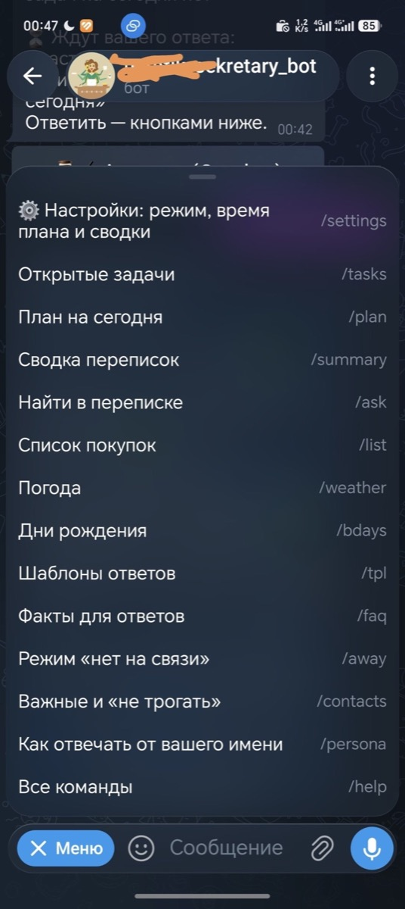
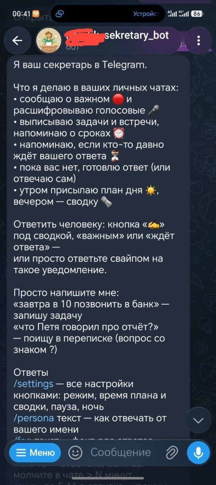
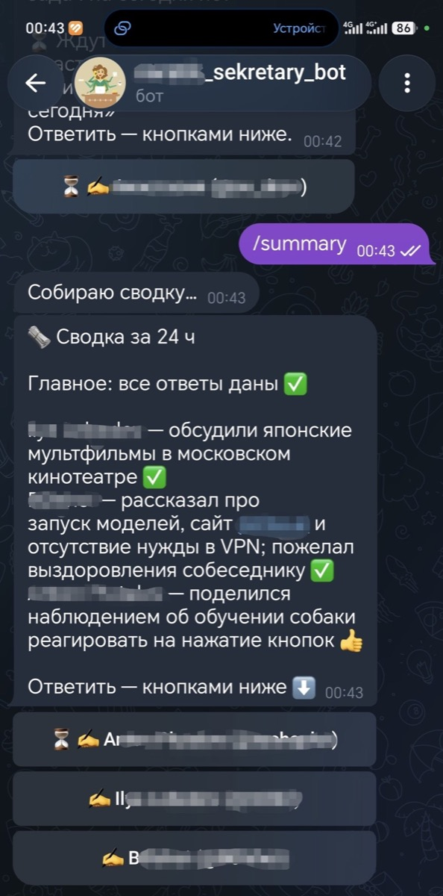
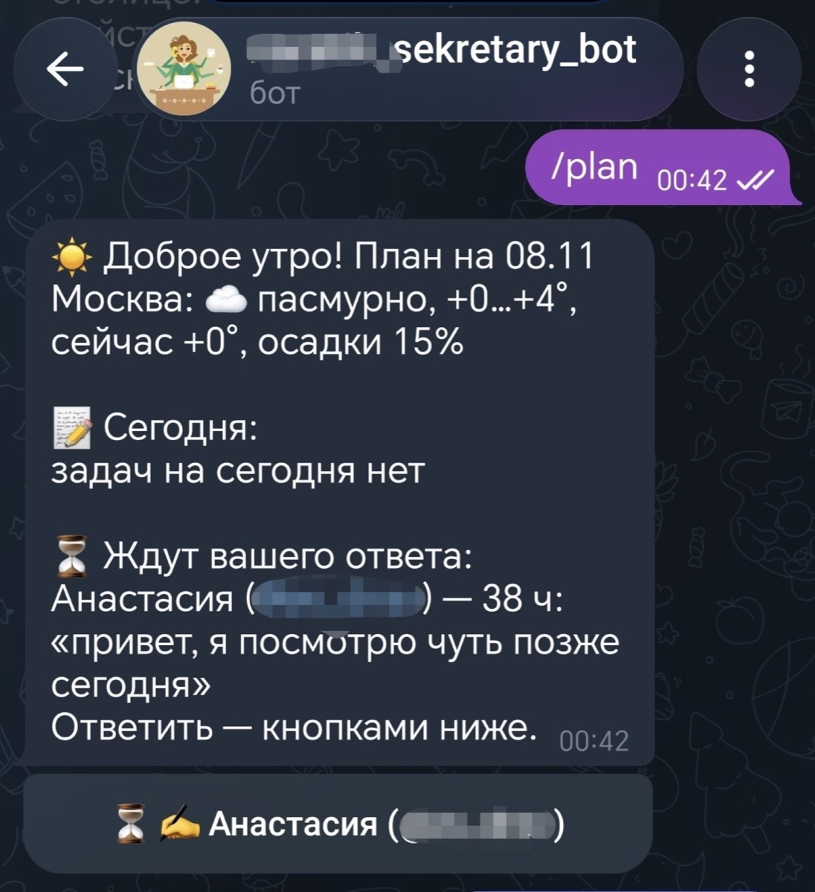
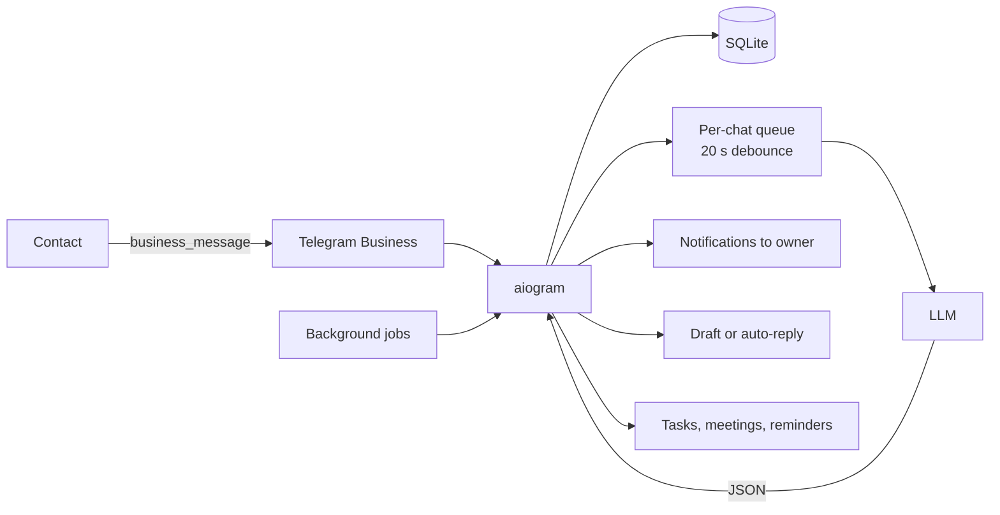

<div align="center">

# 🕵️ Secretary Bot

**A personal Telegram Business secretary: reads your chats, highlights what matters, tracks tasks and meetings, and replies on your behalf.**


[Русский](README.md) · **English**

[Features](#-features) · [How it works](#-how-it-works) · [Quick start](#-quick-start) · [Commands](#-commands) · [Configuration](#-configuration)

</div>

---

## What it is

**Secretary Bot** is a single-user assistant for Telegram. It connects to your account through **Telegram Business → Chat Automation**, sees your personal chats (only messages received after the connection), and uses an LLM to help you keep up.

It is not another chat bot you have to talk to. It works in the background of your existing conversations:

- urgent messages are marked 🔴;
- requests and promises become tasks with reminders;
- appointments become calendar files (`.ics`);
- common questions can be answered from your FAQ;
- when you are busy, the bot prepares a draft or replies for you;
- a morning plan and an evening digest summarise the day.

The bot is **single-user**: it only accepts the owner whose `OWNER_ID` is set in the config. Any other account that connects it is ignored.

> Personal use only. You need **Telegram Premium**, a server with Docker, and an API key for one of the supported LLM providers.

---

## 📸 Screenshots

<table>
  <tr>
    <td align="center"><a href="docs/screenshots/settings.jpg"></a><br><sub>Settings</sub></td>
    <td align="center"><a href="docs/screenshots/important.jpg"></a><br><sub>Important message</sub></td>
  </tr>
  <tr>
    <td align="center"><a href="docs/screenshots/draft.jpg"></a><br><sub>Draft reply</sub></td>
    <td align="center"><a href="docs/screenshots/morning.jpg"></a><br><sub>Morning plan</sub></td>
  </tr>
</table>

---

## ✨ Features

### Chat intelligence
- **Importance filter.** Every batch gets `low` / `normal` / `high`; urgent messages arrive with 🔴.
- **Tasks.** Requests and promises are extracted with deadlines and reminders.
- **Continuation-aware.** If a new message develops an open task, the bot updates it instead of creating a duplicate.
- **Meetings.** Explicit date/time agreements become events with an “📅 Add to calendar” button.
- **Birthdays.** Dates from chats and Telegram profiles; reminders the day before and on the day.
- **Voice messages and video notes.** Transcribed through GigaChat and included in tasks and summaries.

### Replies in your voice
- **`off` / `draft` / `auto` modes.** Notifications only, drafts for approval, or automatic replies.
- **Persona.** `/persona` defines how the bot should write as you.
- **Facts.** `/faq` stores prices, address, hours; the bot answers those precisely.
- **Style learning.** The bot remembers how you edit its drafts and gradually follows your tone.
- **Humanize.** Removes corporate phrasing, “Sure”, “Great question”, markdown, extra emoji, and long dashes, so replies do not look AI-generated.

### Summaries and follow-ups
- **Morning plan** ☀️ and **evening digest** 🗞 with weather, tasks, birthdays, and people waiting for a reply.
- **“You have not replied”** ⏳ reminders after N hours.
- **Chat search** 🔎 with a question mark or `/ask`.
- **Reply from the bot** ✍️ with “Reply” and “Suggest a reply” buttons on summaries and important messages.

### Modes
- **Night mode** 🌙 — automatic replies during a configured interval.
- **Away** 🏝 — tells each person once when you will be back, then sends you a summary.
- **Recovery** ♻️ — after a restart, processes messages that were saved but not analysed.

### Small helpers
- 🛒 Shopping list: `/buy`, `+milk`, `/list`.
- 🌦 Weather: `/city Moscow`, `/weather`.
- 📋 Reply templates: `/tpl`.
- ⭐ VIP contacts and 🚫 ignored contacts: `/vip`, `/ignore`, `/contacts`.
- 🧹 Retention: old data is deleted on schedule (365 days by default).

---

## ⚙️ How it works



1. **Connection.** Telegram sends `business_connection` and `business_message` events for allowed personal chats.
2. **Storage.** The bot verifies the connection belongs to the owner, stores the message in SQLite, and skips `ignore` contacts.
3. **Batching.** New messages wait 20 seconds after the last one in a chat; people often write in bursts. Each chat has its own queue and lock.
4. **Analysis.** The LLM receives recent messages, open tasks, facts, and examples of your style, and returns strict JSON: importance, tasks, events, birthdays, reply text.
5. **Actions.** The bot sends notifications, creates tasks and events, saves a draft, or replies — depending on the mode.
6. **Background work.** Every 30 seconds it checks reminders, unanswered chats, morning plan, evening digest, and retention.

### Safety around the model

- Meetings are filtered in code: past and invented events are dropped.
- Events are deduplicated; the model is asked not to repeat open tasks.
- Chat text is passed as **untrusted data**: a random marker, escaped angle brackets, sanitized names, and a rule forbidding the model to follow instructions from messages.
- Replies go through `humanize`; facts and persona are controlled by the owner.

---

## 🚀 Quick start

### Requirements

| Component | Requirement |
|---|---|
| Telegram | **Premium** for Chat Automation |
| Server | Linux VPS with Docker; 512 MB RAM is enough |
| LLM | GigaChat, YandexGPT, Claude, or local Ollama |
| Bot | Token from [@BotFather](https://t.me/BotFather) |

### 1. Create the bot

1. In [@BotFather](https://t.me/BotFather): `/newbot` → name → token.
2. `/mybots` → your bot → **Bot Settings → Secretary Mode → Turn on**.
   Older versions call it **Business Mode**.
3. Without this, Telegram will not let you connect the bot to your account.

### 2. Run on the server

The easy way:

```bash
apt-get install -y git
git clone https://github.com/bogatkin82-jpg/secretary-bot
bash secretary-bot/setup.sh
```

The script installs Docker, asks for the bot token, your Telegram ID, and an LLM key, creates `.env`, and starts the container.

Manual install:

```bash
git clone https://github.com/bogatkin82-jpg/secretary-bot
cd secretary-bot
cp .env.example .env
nano .env          # BOT_TOKEN, OWNER_ID, LLM key

mkdir -p data
sudo chown -R 10001:10001 data
docker compose up -d --build
```

Logs:

```bash
docker compose logs -f
```

> **Do not know your `OWNER_ID`?** Set `OWNER_ID=1` temporarily, start the bot, and send it `/start`; it will reply with your Telegram ID. Put that ID in `.env` and restart the container.

### 3. Connect the bot to your account

1. Send `/start` to the bot first; otherwise it cannot send you notifications.
2. Telegram → Settings → **Telegram Business → Chat Automation**.
3. Enter your bot's `@username`.
4. “Chats available to the bot” — **“All personal chats except…”**; add people who must never be touched.
5. Enable **“Reply to messages”**; otherwise you only get summaries and tasks.

The bot will send “✅ Bot connected to your account”.

### Updating

```bash
cd ~/secretary-bot
git pull
sudo chown -R 10001:10001 data
docker compose up -d --build
```

---

## 💬 Commands

Full list: `/help`.

### Mode and style
| Command | What it does |
|---|---|
| `/settings` | All settings as buttons |
| `/mode off\|draft\|auto` | Disable replies / drafts / automatic replies |
| `/persona text` | How to reply as you |
| `/idle 15` | Reply if you have been silent in a chat for N minutes |
| `/voice on\|off` | Voice transcription |

### Tasks
| Command | What it does |
|---|---|
| `/tasks` | Open tasks with buttons |
| `/time 2 tomorrow at 15` | Reschedule task #2 |
| `/done 3` / `/del 3` | Complete / delete task |
| plain text to the bot | New task, e.g. “call the bank tomorrow at 10” |

### Summaries and search
| Command | What it does |
|---|---|
| `/plan` | Today's plan now |
| `/summary 8` | Summary for the last 8 hours |
| `/digest 21:00` / `off` | Evening digest time |
| `/morning 09:00` / `off` | Morning plan time |
| `/wait 3` / `off` | Remind about unanswered chats after N hours |
| `/ask question` or “question?” | Search your chats |

### Contacts and modes
| Command | What it does |
|---|---|
| `/vip name` | VIP contact: always 🔴, reminder after an hour |
| `/ignore name` | Do not read; delete history and metadata |
| `/normal name\|ID` | Return to normal |
| `/contacts` | VIP and ignored contacts; restore buttons |
| `/away until 5 Nov, vacation` / `/back` | Away mode |
| `/night 23:00-08:00` / `off` | Night mode |

### Helpers
| Command | What it does |
|---|---|
| `/faq text` / `/faq` | Facts for replies |
| `/tpl words \| reply` / `/tpl` | Reply templates |
| `/city Moscow` / `/weather` | City and weather |
| `/buy milk, bread` / `+milk` / `/list` | Shopping list |
| `/bday Mary 15.03` / `/bdays` | Birthdays |

---

## 🔧 Configuration

All settings live in `.env`, created from `.env.example`.

### Core
| Variable | Default | Purpose |
|---|---|---|
| `BOT_TOKEN` | — | BotFather token |
| `OWNER_ID` | — | Your numeric Telegram ID |
| `TZ_NAME` | `Europe/Moscow` | Time zone |
| `DB_PATH` | `data/secretary.db` | SQLite path |

### LLM
| Variable | Default | Purpose |
|---|---|---|
| `GIGACHAT_AUTH_KEY` | — | GigaChat key |
| `YANDEX_API_KEY`, `YANDEX_FOLDER_ID` | — | YandexGPT |
| `ANTHROPIC_API_KEY` | — | Claude |
| `LOCAL_LLM_URL`, `LOCAL_LLM_MODEL` | — | Ollama / LM Studio, OpenAI-compatible API |
| `LLM_PROVIDER` | by key | `gigachat`, `yandex`, `claude`, `local` |
| `LLM_MODEL` | `GigaChat-2` | Analysis model |
| `SUMMARY_MODEL` | `GigaChat-2-Pro` | Summary model |
| `VOICE_MODEL` | `GigaChat-2-Pro` | Voice model |
| `HISTORY_LIMIT` | `30` | Messages sent to the model |

### Behaviour
| Variable | Default | Purpose |
|---|---|---|
| `DEBOUNCE_SECONDS` | `20` | Batch wait |
| `MAX_AUTOREPLIES_PER_HOUR` | `2` | Auto-reply limit per chat per hour |
| `RECOVERY_ENABLED` | `true` | Process saved messages after restart |
| `DAILY_WINDOW_HOURS` | `3` | Delivery window for plan/digest |
| `DAILY_RETRY_MINUTES` | `10` | Retry interval after a send error |
| `RETENTION_DAYS` | `365` | Keep data for N days; `0` disables cleanup |

### Local model

The bot can use Ollama on your Mac/PC through an OpenAI-compatible API, with GigaChat as a fallback. While the computer is available, chats stay local; when it sleeps, the bot switches to the cloud.

```env
LOCAL_LLM_URL=http://100.x.y.z:11434/v1
LOCAL_LLM_MODEL=qwen2.5:7b
```

Use a **non-reasoning** model for this bot. Reasoning models spend tokens on hidden “thinking”, return invalid JSON, and make every request slow.

---

## 🔒 Privacy and security

- **Owner only.** Every update is checked against `OWNER_ID`; other connections are ignored.
- **`ignore`.** No new messages are stored; old history, name, and `@username` are deleted. Only `chat_id` and status remain so the bot knows whom to ignore.
- **Your data stays with you.** Chats are stored in `data/secretary.db` on your server. Back up the `data` folder.
- **What goes to the LLM.** Up to 30 messages for analysis, up to 60 for a summary; voice messages go to GigaChat. Check your provider's policy.
- **Local mode.** With `LOCAL_LLM_URL`, chats may stay on your machine (except voice).
- **Prompt injection.** Messages are wrapped in a random marker, `<`/`>` are escaped, names are sanitized, and the model is told not to follow instructions from chat text. This reduces risk but does not eliminate it.
- **Retention.** Data older than 365 days is deleted by default; `RETENTION_DAYS=0` disables cleanup.
- **No encryption.** SQLite is not encrypted; access equals server access. Never commit `.env` or `data`.

---

## ⚠️ Limitations

- Requires **Telegram Premium** and Chat Automation.
- **Personal chats only**; groups and channels are not supported.
- Only messages received **after connection** are visible.
- Voice transcription requires **GigaChat**.
- Photos and files are analysed by caption only; no OCR.
- One owner and one bot instance (long polling + SQLite).
- No web or mobile UI.
- Replies in `auto` are sent as you; review persona and facts.

---

## 🛠 Development

```bash
python3.12 -m venv .venv
. .venv/bin/activate
pip install -r requirements.txt
cp .env.example .env
python -m bot
```

Tests:

```bash
python -m unittest discover -s tests -v
```

Tests do not require real keys or network access. They cover database logic, retention, recovery, `ignore`, and prompt protection.

The Docker image runs as a non-root user (UID/GID `10001`). Make sure the data directory is writable by that user:

```bash
sudo chown -R 10001:10001 data
```

Project layout and detailed Russian documentation: [README.md](README.md).

---

## 🤝 Contributing

Issues and pull requests are welcome. Before opening a PR:

```bash
python -m unittest discover -s tests -v
```

Do not commit `.env`, `data/`, or real tokens. Add tests for new features and update the README.

---

## 📄 License

[MIT](LICENSE) © 2026 Aleksey Bogatkin.

You may use, modify, and distribute this project with the copyright notice preserved.

---

<sub>This English README covers the essentials. The [Russian README](README.md) is the primary and most detailed version.</sub>
