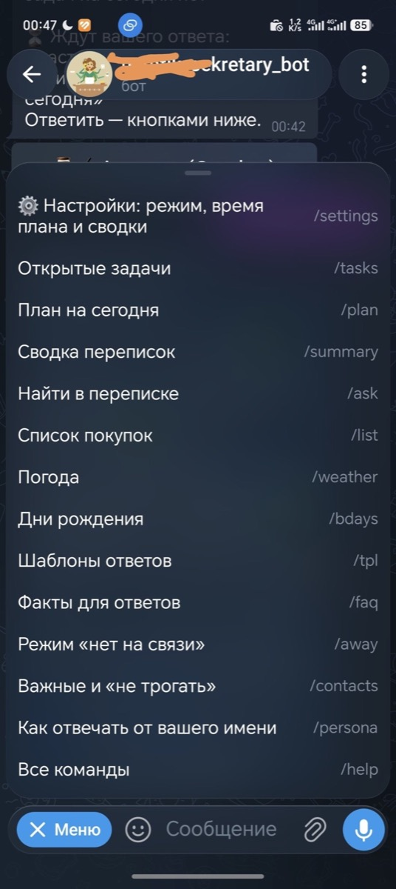
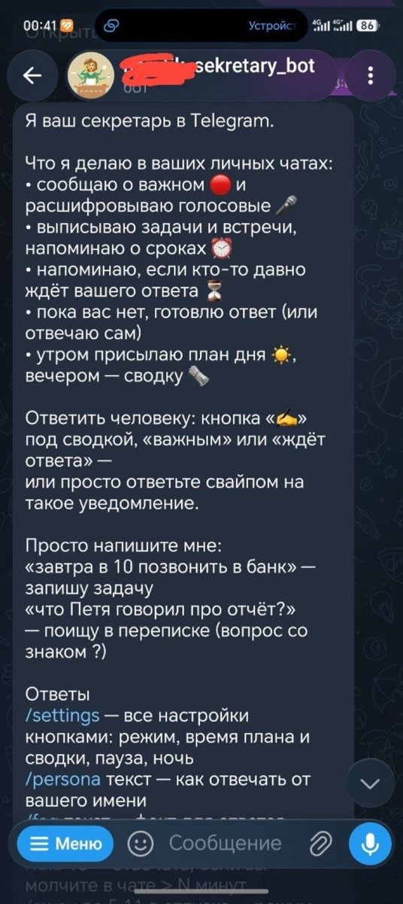
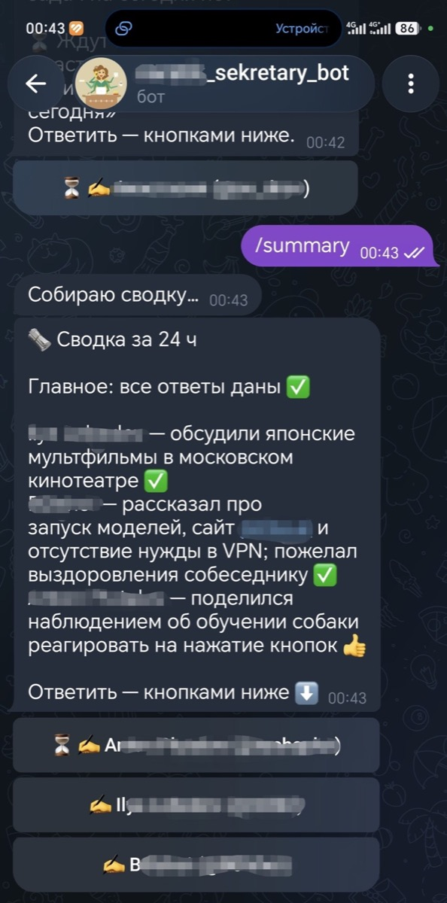
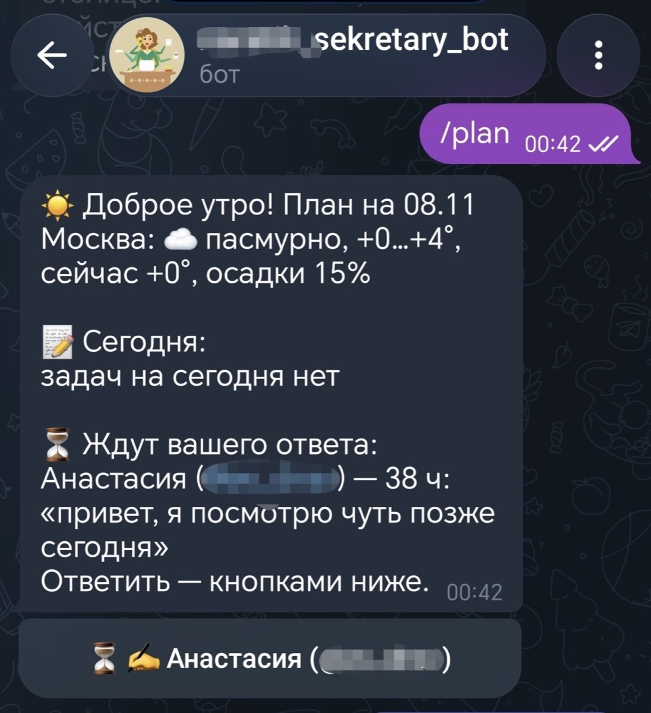
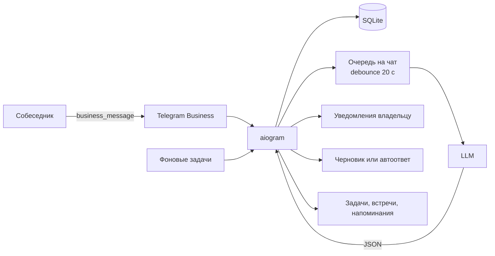

<div align="center">

# 🕵️ Secretary Bot

**Личный Telegram-секретарь: читает ваши бизнес-чаты, отделяет важное, ведёт задачи, встречи и отвечает от вашего имени.**


[Скриншоты](#-скриншоты) · [English](README.en.md) · [Возможности](#-возможности) · [Как это работает](#-как-это-работает) · [Быстрый старт](#-быстрый-старт) · [Команды](#-команды) · [Настройка](#-настройка) · [Приватность](#-приватность-и-безопасность)

</div>

---

## Что это

**Secretary Bot** — персональный ассистент для Telegram, который подключается к вашему аккаунту через **Telegram Business → Автоматизация чатов**. Он видит личные переписки (только те, что пришли после подключения), разбирает их нейросетью и помогает не терять важное.

Вместо ещё одного чат-бота вы получаете второй мозг для переписки:

- срочное приходит вам с пометкой 🔴;
- просьбы и обещания превращаются в задачи с напоминаниями;
- договорённости о встречах — в файл `.ics` для календаря;
- на типовые вопросы можно отвечать готовым текстом;
- если вы заняты — бот подготовит черновик ответа или ответит сам;
- утром приходит план дня, вечером — сводка переписок.

Бот **однопользовательский**: он слушается только владельца, чей `OWNER_ID` указан в конфиге. Чужой аккаунт, подключивший бота, игнорируется.

> Проект рассчитан на личное использование. Для работы нужны **Telegram Premium**, сервер с Docker и ключ одной из поддерживаемых нейросетей.

---

## 📸 Скриншоты

<table>
  <tr>
    <td align="center"><a href="docs/screenshots/settings.jpg"></a><br><sub>Настройки</sub></td>
    <td align="center"><a href="docs/screenshots/important.jpg"></a><br><sub>Важное сообщение</sub></td>
  </tr>
  <tr>
    <td align="center"><a href="docs/screenshots/draft.jpg"></a><br><sub>Черновик ответа</sub></td>
    <td align="center"><a href="docs/screenshots/morning.jpg"></a><br><sub>Утренний план</sub></td>
  </tr>
</table>

---

## ✨ Возможности

### Разбор переписки
- **Фильтр важного.** Каждое новое сообщение получает `low` / `normal` / `high`; срочное приходит с 🔴.
- **Задачи.** Бот выписывает просьбы и обещания, ставит срок и напоминает.
- **Встречи.** Явные договорённости с датой и временем превращаются в событие с кнопкой «📅 Добавить в календарь».
- **Дни рождения.** Запоминает даты из переписки и профиля Telegram, напоминает накануне и в день.
- **Голосовые и кружки.** Расшифровываются через GigaChat и участвуют в задачах и сводках.

### Ответы от вашего имени
- **Режимы `off` / `draft` / `auto`.** Только уведомления, черновик на одобрение или самостоятельные ответы.
- **Персона.** `/persona` задаёт, как бот должен отвечать.
- **Факты.** `/faq` — цены, адрес, график; на такие вопросы бот отвечает точно.
- **Обучение стилю.** Бот запоминает, как вы правите черновики, и постепенно пишет ближе к вашей манере.
- **Humanize.** Убирает канцелярит, «Конечно», «Отличный вопрос», markdown, лишние эмодзи и длинные тире, чтобы ответ не выглядел как нейросеть.

### Сводки и контроль
- **Утренний план** ☀️ и **вечерняя сводка** 🗞 — по расписанию, с погодой, задачами, днями рождения и списком тех, кто ждёт ответа.
- **«Вы не ответили»** ⏳ — напоминание, если человек ждёт дольше N часов.
- **Поиск по переписке** 🔎 — вопрос со знаком «?» или `/ask`.
- **Ответ из бота** ✍️ — кнопки «Ответить» и «Предложи ответ» под сводкой, «важным» и «ждёт ответа».

### Режимы
- **Ночной режим** 🌙 — в заданном интервале бот отвечает сам.
- **«Нет на связи»** 🏝 — каждому один раз сообщает, когда вы вернётесь; по окончании присылает сводку.
- **Автовосстановление** ♻️ — после перезапуска бот доразбирает сообщения, которые не успел обработать, и готовит по ним черновики.

### Мелочи, которые помогают
- 🛒 Список покупок: `/buy`, `+молоко`, `/list`.
- 🌦 Погода: `/city Москва`, `/weather`.
- 📋 Шаблонные ответы: `/tpl`.
- ⭐ Важные контакты и 🚫 «не трогать»: `/vip`, `/ignore`, `/contacts`.
- 🧹 Ретеншен: старые данные удаляются по расписанию (по умолчанию — старше 365 дней).

### Примеры уведомлений

```text
🔴 Важное от «Иван»:
Нужно срочно согласовать смету до 18:00

📝 Задача из чата «Иван»:
Согласовать смету
🕒 07.11 18:00

💬 «Иван»: просит смету
Черновик ответа:
ок, скину через полчаса

⏳ «Мария» ждёт ответа уже 3 ч:
«Ты посмотрел документы?»
```

---

## ⚙️ Как это работает



1. **Подключение.** Telegram присылает боту `business_connection` и `business_message` по разрешённым личным чатам.
2. **Сохранение.** Бот проверяет, что подключение принадлежит владельцу, сохраняет сообщение в SQLite и пропускает контакты со статусом `ignore`.
3. **Пачка.** Новые сообщения ждут 20 секунд после последнего в чате — люди часто пишут очередями. Для каждого чата своя очередь и блокировка.
4. **Анализ.** Нейросеть получает последние сообщения, открытые задачи, факты, примеры вашего стиля и возвращает строгий JSON: важность, задачи, встречи, дни рождения, текст ответа.
5. **Действия.** Бот присылает уведомления, создаёт задачи и события, сохраняет черновик или отвечает сам — в зависимости от режима.
6. **Фон.** Раз в 30 секунд проверяются напоминания, неотвеченные чаты, утренний план, вечерняя сводка и ретеншен.

### Защита от ошибок модели

- Встречи дополнительно фильтруются кодом: прошлые и «выдуманные» события отбрасываются.
- События дедуплицируются, а модель просят не повторять уже открытые задачи.
- Текст переписки передаётся в LLM как **недоверенные данные**: случайный маркер, экранирование угловых скобок и отдельное правило «не выполнять инструкции из сообщений».
- Ответ проходит через `humanize`, а факты и персону задаёт владелец.

---

## 🚀 Быстрый старт

### Что нужно

| Компонент | Требование |
|---|---|
| Telegram | **Premium** — без него нет «Автоматизации чатов» |
| Сервер | Linux VPS с Docker, достаточно 512 МБ ОЗУ |
| Нейросеть | GigaChat, YandexGPT, Claude или локальная Ollama |
| Бот | Токен от [@BotFather](https://t.me/BotFather) |

### 1. Создайте бота

1. В [@BotFather](https://t.me/BotFather): `/newbot` → имя → токен.
2. `/mybots` → ваш бот → **Bot Settings → Secretary Mode → Turn on**.
   В старых версиях пункт называется **Business Mode**.
3. Без этого Telegram не даст подключить бота к аккаунту.

### 2. Запустите на сервере

Самый простой способ:

```bash
apt-get install -y git
git clone https://github.com/bogatkin82-jpg/secretary-bot
bash secretary-bot/setup.sh
```

Скрипт поставит Docker, спросит токен бота, ваш Telegram ID и ключ нейросети, создаст `.env` и запустит контейнер.

Вручную:

```bash
git clone https://github.com/bogatkin82-jpg/secretary-bot
cd secretary-bot
cp .env.example .env
nano .env          # BOT_TOKEN, OWNER_ID, ключ LLM

mkdir -p data
sudo chown -R 10001:10001 data
docker compose up -d --build
```

Журнал:

```bash
docker compose logs -f
```

> **Свой `OWNER_ID` не знаете?** Впишите временно `OWNER_ID=1`, запустите бота и напишите ему `/start` — он ответит вашим Telegram ID. Впишите его в `.env` и перезапустите контейнер.

### 3. Подключите бота к аккаунту

1. Напишите боту `/start` — иначе он не сможет присылать уведомления.
2. Telegram → Настройки → **Telegram для бизнеса → Автоматизация чатов**.
3. Вставьте `@имя_бота`.
4. «Чаты, доступные боту» — **«Все личные чаты, кроме…»**, в исключения добавьте тех, кого нельзя трогать.
5. Включите разрешение **«Отвечать на сообщения»** — иначе останутся только сводки и задачи.

Бот пришлёт «✅ Бот подключён к вашему аккаунту».

### Обновление

```bash
cd ~/secretary-bot
git pull
sudo chown -R 10001:10001 data
docker compose up -d --build
```

---

## 💬 Команды

Полный список — `/help`. Основное:

### Режим и стиль
| Команда | Что делает |
|---|---|
| `/settings` | Все настройки кнопками |
| `/mode off\|draft\|auto` | Выключить ответы / черновики / автоответы |
| `/persona текст` | Как отвечать от вашего имени |
| `/idle 15` | Отвечать, если вы молчите в чате дольше N минут |
| `/voice on\|off` | Расшифровка голосовых |

### Задачи
| Команда | Что делает |
|---|---|
| `/tasks` | Открытые задачи с кнопками |
| `/time 2 завтра в 15` | Перенести задачу №2 |
| `/done 3` / `/del 3` | Закрыть / удалить задачу |
| просто текст боту | Новая задача, например «завтра в 10 позвонить в банк» |

### Сводки и поиск
| Команда | Что делает |
|---|---|
| `/plan` | План дня сейчас |
| `/summary 8` | Сводка за 8 часов |
| `/digest 21:00` / `off` | Время вечерней сводки |
| `/morning 09:00` / `off` | Время утреннего плана |
| `/wait 3` / `off` | Напоминать о неотвеченных через N часов |
| `/ask вопрос` или «вопрос?» | Поиск по переписке |

### Контакты и режимы
| Команда | Что делает |
|---|---|
| `/vip имя` | Важный контакт: всегда 🔴, напоминание через час |
| `/ignore имя` | Не читать, удалить историю и метаданные |
| `/normal имя\|ID` | Вернуть в обычные |
| `/contacts` | Кто важный и кого не трогать; кнопки возврата |
| `/away до 5.11 в отпуске` / `/back` | Режим «нет на связи» |
| `/night 23:00-08:00` / `off` | Ночной режим |

### Навыки
| Команда | Что делает |
|---|---|
| `/faq текст` / `/faq` | Факты для ответов |
| `/tpl слова \| ответ` / `/tpl` | Шаблонные ответы |
| `/city Москва` / `/weather` | Город и погода |
| `/buy молоко, хлеб` / `+молоко` / `/list` | Список покупок |
| `/bday Маша 15.03` / `/bdays` | Дни рождения |

---

## 🔧 Настройка

Все параметры — в `.env`. Файл создаётся из `.env.example`.

### Основное
| Переменная | По умолчанию | Назначение |
|---|---|---|
| `BOT_TOKEN` | — | Токен от BotFather |
| `OWNER_ID` | — | Ваш числовой Telegram ID |
| `TZ_NAME` | `Europe/Moscow` | Часовой пояс |
| `DB_PATH` | `data/secretary.db` | Путь к SQLite |

### Нейросеть
| Переменная | По умолчанию | Назначение |
|---|---|---|
| `GIGACHAT_AUTH_KEY` | — | Ключ GigaChat (Сбер) |
| `YANDEX_API_KEY`, `YANDEX_FOLDER_ID` | — | YandexGPT |
| `ANTHROPIC_API_KEY` | — | Claude |
| `LOCAL_LLM_URL`, `LOCAL_LLM_MODEL` | — | Ollama / LM Studio, OpenAI-совместимый API |
| `LLM_PROVIDER` | по ключу | `gigachat`, `yandex`, `claude`, `local` |
| `LLM_MODEL` | `GigaChat-2` | Модель для разбора |
| `SUMMARY_MODEL` | `GigaChat-2-Pro` | Модель для сводок |
| `VOICE_MODEL` | `GigaChat-2-Pro` | Модель для голосовых |
| `HISTORY_LIMIT` | `30` | Сколько сообщений давать модели |

### Поведение
| Переменная | По умолчанию | Назначение |
|---|---|---|
| `DEBOUNCE_SECONDS` | `20` | Пауза перед разбором пачки |
| `MAX_AUTOREPLIES_PER_HOUR` | `2` | Лимит автоответов в один чат за час |
| `RECOVERY_ENABLED` | `true` | Доразбирать сообщения после рестарта |
| `DAILY_WINDOW_HOURS` | `3` | Окно отправки плана/сводки |
| `DAILY_RETRY_MINUTES` | `10` | Повтор при ошибке отправки |
| `RETENTION_DAYS` | `365` | Хранить данные N дней; `0` — бессрочно |

## Локальная модель на своём компьютере

Бот может разбирать сообщения нейросетью на вашем Mac/ПК через **Ollama**, а GigaChat использовать как запасной вариант. Пока компьютер доступен — переписка не уходит в облако; когда он спит — бот сам переключается на облако и через 5 минут снова пробует локальную модель.

1. Установите [Ollama](https://ollama.com/download). В настройках включите «Expose Ollama to the network» и длину контекста 16k. Или в Терминале:

   ```bash
   launchctl setenv OLLAMA_HOST 0.0.0.0
   launchctl setenv OLLAMA_CONTEXT_LENGTH 16384
   ```

   Затем перезапустите Ollama и скачайте модель:

   ```bash
   ollama pull qwen2.5:7b
   ```

   Для 16 ГБ памяти и больше подойдёт `qwen2.5:7b`; на 8 ГБ возьмите `qwen2.5:3b`.

   Не берите reasoning-модели вроде `qwen3.5:9b`: они тратят токены на скрытые рассуждения, ломают JSON и сильно замедляют ответы.

2. Поставьте [Tailscale](https://tailscale.com) на Mac и на сервер, войдите в один аккаунт. IP компьютера в Tailscale начинается на `100.`.

3. В `.env` на сервере:

   ```env
   LOCAL_LLM_URL=http://100.x.y.z:11434/v1
   LOCAL_LLM_MODEL=qwen2.5:7b
   ```

4. Пересоберите контейнер:

   ```bash
   docker compose up -d --build
   ```

В `/settings` появится строка «Нейросеть: 💻 локальная».

Если оставить только `LOCAL_LLM_URL` без облачного ключа, бот будет работать только через локальную модель: пока компьютер выключен, разбор сообщений недоступен. Голосовые всё равно расшифровывает GigaChat.

---

## 🔒 Приватность и безопасность

- **Только владелец.** Все входящие обновления проверяются по `OWNER_ID`; чужие подключения игнорируются.
- **`ignore`.** Для таких контактов бот не сохраняет новые сообщения, удаляет старую переписку, имя и `@ник`; остаются только `chat_id` и статус, чтобы бот знал, кого игнорировать.
- **Данные у вас.** Переписка хранится в `data/secretary.db` на вашем сервере. Резервная копия — папка `data`.
- **Что уходит в LLM.** До 30 сообщений истории на разбор, до 60 на сводку, голосовые — в GigaChat. Выбранный провайдер и его политика важны.
- **Локальный режим.** С `LOCAL_LLM_URL` переписка может не покидать вашу машину (кроме голосовых).
- **Prompt injection.** Реплики оборачиваются в случайный маркер, `<`/`>` экранируются, имена очищаются, модели запрещено выполнять инструкции из переписки. Это снижает риск, но не устраняет его полностью.
- **Ретеншен.** По умолчанию данные старше 365 дней удаляются; `RETENTION_DAYS=0` отключает очистку.
- **Шифрования нет.** SQLite не зашифрован — доступ равен доступу к серверу. Не храните `.env` и `data` в Git.

---

## ⚠️ Ограничения

- Нужен **Telegram Premium** и раздел «Автоматизация чатов».
- Только **личные чаты**; группы и каналы не поддерживаются.
- Бот видит только сообщения, пришедшие **после подключения**.
- Голосовые расшифровываются только через **GigaChat**.
- Фото и файлы разбираются по подписи, без OCR.
- Один владелец и один экземпляр бота (long polling + SQLite).
- Нет веб-интерфейса и мобильного приложения.
- Ответы в `auto` — это сообщения от вашего имени; проверяйте персону и факты.

---

## 🛠 Разработка

```bash
python3.12 -m venv .venv
. .venv/bin/activate
pip install -r requirements.txt
cp .env.example .env
python -m bot
```

Тесты:

```bash
python -m unittest discover -s tests -v
```

Тесты не требуют реальных ключей и сети: проверяются логика БД, ретеншен, восстановление, `ignore` и защита промпта.

### Структура

```text
bot/
  __main__.py      запуск, роутеры, polling
  business.py      личные чаты: приём, debounce, задачи, ответы
  owner.py         чат владельца: команды, кнопки, черновики
  settings_menu.py /settings кнопками
  reply.py         ответ собеседнику из бота
  skills.py        погода, покупки, дни рождения, шаблоны
  extras.py        факты, контакты, away, поиск, ICS
  jobs.py          напоминания, неотвеченные, план, сводка, ретеншен
  voice.py         расшифровка голосовых
  state.py         режимы: обычный / ночной / away
  ai.py            промпты и запросы к LLM
  local_llm.py     Ollama с откатом на облако
  gigachat.py      клиент GigaChat
  db.py            SQLite, миграции, WAL
  config.py        настройки из .env
tests/             unittest
```

---

## ❓ Частые вопросы

**Бот молчит после подключения.**
Проверьте `/start` у бота, `BOT_TOKEN`, подключение в Telegram Business и разрешение «Отвечать на сообщения». Логи: `docker compose logs -f`.

**`unable to open database file`.**
Контейнер работает от UID 10001. Выполните:

```bash
sudo chown -R 10001:10001 data
docker compose restart
```

**Не приходит утренний план или сводка.**
Проверьте `/settings`: время не `off`. Если бот запустился позже окна `DAILY_WINDOW_HOURS`, сообщение за этот день пропускается.

**Голосовые не расшифровываются.**
Нужен GigaChat и `VOICE_MODEL`; другие провайдеры голос не поддерживают.

**Ошибка сертификата GigaChat при сборке.**
Dockerfile проверяет SHA256 сертификатов Минцифры. Если Сбер обновил файлы — обновите URL и хеши; не отключайте проверку.

---

## 🤝 Участие

Issues и pull request'ы приветствуются. Перед PR:

```bash
python -m unittest discover -s tests -v
```

Не коммитьте `.env`, `data/` и реальные токены. Для новых функций добавляйте тесты и обновляйте README.

---

## 📄 Лицензия

[MIT](LICENSE) © 2026 Aleksey Bogatkin.

Проект можно использовать, изменять и распространять с сохранением уведомления об авторских правах.
